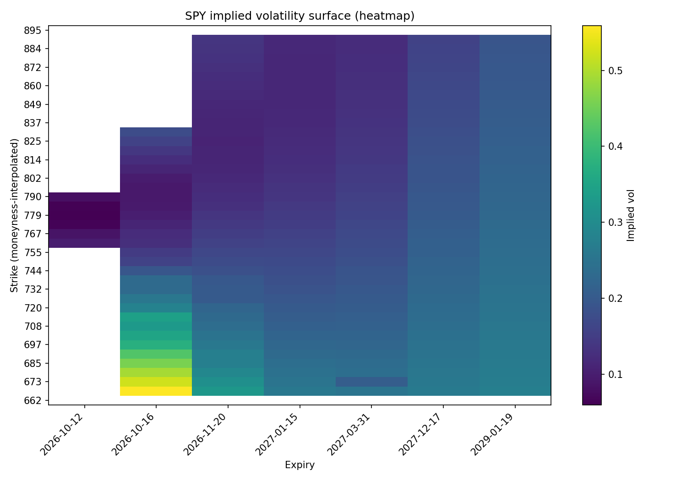
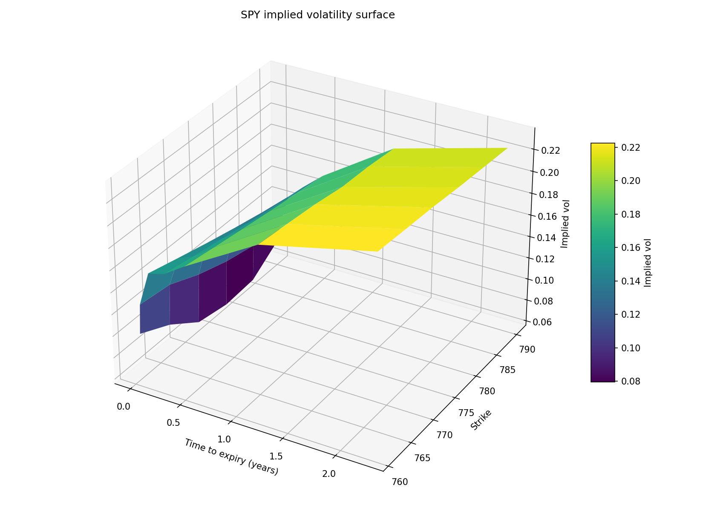

# Implied volatility surface & Greeks

Takes a live SPY option chain from Yahoo Finance, inverts Black-Scholes to
get implied volatility for every strike/expiry, computes delta/gamma/vega,
and plots the strike × expiry surface.




## Why this project

Implied vol is the thing options actually trade on — not the premium itself,
which just reflects spot, strike, time and rates. Inverting Black-Scholes to
recover it, and shaping the result into a surface, is a small, self-contained
way to show I can go from a pricing model to working code to something you
can look at and reason about.

## What it does

1. Pulls the full option chain for a ticker across several expiries
   ([`src/data_fetch.py`](src/data_fetch.py)) — no API key, Yahoo's free
   endpoint via `yfinance`.
2. Cleans the chain: drops quotes with no bid/ask or a crossed market
   (`bid > ask`, which shows up in Yahoo's feed more often than I expected),
   takes the mid price as "the market price" ([`src/surface.py`](src/surface.py)).
3. Inverts Black-Scholes for implied vol using Brent's method, after
   checking the market price actually sits inside the no-arbitrage bounds
   for *any* vol — otherwise Brent either throws an opaque sign error or
   (worse) returns a number that looks like a vol but means nothing
   ([`src/black_scholes.py`](src/black_scholes.py)).
4. Computes delta, gamma, vega from the solved vol.
5. Plots a heatmap and a 3D surface ([`src/plotting.py`](src/plotting.py)).

Run it yourself:

```bash
pip install -r requirements.txt
python -m src.build_live_surface SPY --n-expiries 7 --spread --out-prefix outputs/spy_surface
```

## Acceptance check: does the implied vol actually reproduce the market price?

That's the real test for an implied-vol solver — not that it runs, but that
feeding the solved sigma back into Black-Scholes reproduces the market mid
price you started from. `tests/test_surface.py::test_implied_vol_round_trips...`
does exactly that against a frozen real SPY chain
(`tests/fixtures/spy_*.csv`, captured 2026-10-10), and asserts the repricing
error stays under **1 cent** across every strike that priced successfully.
In practice it's floating-point noise (`xtol=1e-8` on the Brent solve), not
model error — the 1-cent bound is generous on purpose so the test is about
correctness, not about how tight I can make the solver.

I froze a real chain instead of mocking `yfinance` or using synthetic prices,
because the whole point of this check is that it holds against an actual
bid/ask spread quoted by actual market makers, not numbers I picked so the
test would pass.

## Known limitations (declared, not hidden)

- **Rates and dividend yield are hardcoded**, not fetched
  (`RISK_FREE_RATE = 0.0385`, `DIVIDEND_YIELD = 0.012` in
  `src/build_live_surface.py`). A real desk pulls these from a live curve —
  see Project 2 for the curve side of that. Wiring the two together was out
  of scope here; the point of this project is the vol surface, not the rates
  curve.
- **Very short-dated, far-OTM options produce unstable implied vols.** With
  almost no time value left, a one-cent bid/ask move swings the solved sigma
  by tens of vol points. This isn't a bug — it's what the market actually
  does near expiry on strikes nobody's quoting seriously — but it means the
  3D surface plot restricts itself to a moneyness band and a common strike
  grid across expiries (see next point), rather than plotting every strike
  Yahoo returns.
- **Both plots interpolate each expiry's smile onto a shared moneyness grid**
  (`src/plotting.py::_interpolated_grid`), instead of plotting the raw
  strike pivot directly. Different expiries are quoted at different strike
  increments — near-dated weeklies trade every \$1, far LEAPS every \$20-25 —
  so a raw strike × expiry table is mostly empty cells between expiries that
  share no strike. The interpolation is 1D linear, per expiry, over
  moneyness (`K/spot`), between implied vols that were actually computed
  from real quoted strikes — it resamples an already-estimated curve, it
  does not invent a quote. A unit test
  (`test_interpolated_grid_values_stay_within_observed_vol_range`) asserts
  the interpolated grid never produces a vol outside the min/max actually
  observed on that expiry, which is what distinguishes "resampling a curve"
  from "making something up". Expiries with fewer than 3 priced strikes in
  the moneyness band are dropped from the plot rather than guessed at. The
  CSV export (`outputs/*_data.csv`) always has the raw, non-interpolated,
  per-real-strike data, errors included.
- **Calendar days / 365.25, not a trading-day calendar.** Fine at this
  tolerance; would matter for a product actually quoting short-dated theta.
- **No American-exercise adjustment.** SPY options are American-style in
  practice; this uses the European Black-Scholes model throughout. For
  near-the-money, non-dividend-heavy names the early-exercise premium is
  small, but it's not zero, and this doesn't correct for it.

## What failed on the way here

The first version of the heatmap plotted every strike Yahoo returned,
unfiltered. It came back as a mostly-white image with illegible y-axis
labels — too many strikes, and expiries with gaps in their strike coverage
rendered as blank stripes. Filtering to a moneyness band and thinning the
y-ticks made it readable, but still full of white gaps, because even
"nearby" expiries rarely share an exact strike.

The first version of the 3D surface was worse: `plot_surface` interpolates
straight across `NaN` gaps, so missing strikes on some expiries produced
sharp spurious spikes that looked like real features of the vol surface but
were rendering artifacts. Restricting to the strike intersection across
expiries fixed the spikes, but when I tried it with expiries spread across
a year instead of all in the same month (closer to what a real surface
should span), the intersection was nearly empty — monthly and LEAPS
expiries almost never share a strike at all, so there was almost nothing
left to plot.

The actual fix was to stop pivoting on raw strikes and interpolate each
expiry's smile onto a shared moneyness grid instead — both plots now use
that. It needed a dedicated test
(`test_interpolated_grid_values_stay_within_observed_vol_range`) to make
sure interpolation stays inside the real observed vol range per expiry,
because at that point it's doing something to the data and I wanted a
check that catches an interpolation bug overshooting past real quotes,
not just "the plot renders".

## Tests

```bash
python -m pytest tests/ -v
```

20 tests covering: Black-Scholes pricing against a textbook value, put-call
parity, implied-vol round-tripping, no-arbitrage bound checks, Greeks sign
and symmetry, chain cleaning, the end-to-end surface build against a frozen
real chain, the moneyness-interpolation bound check, and plotting smoke
tests. One test is skipped when the fixture chain doesn't extend far enough
OTM to exercise that edge case — documented in the test itself, not
silently passing.
